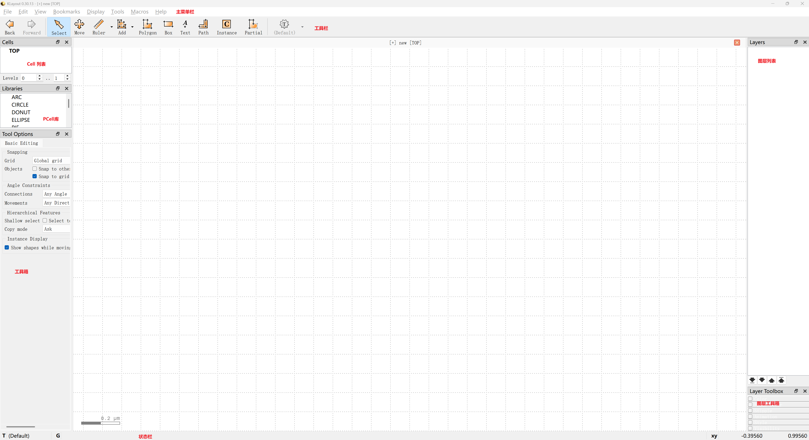
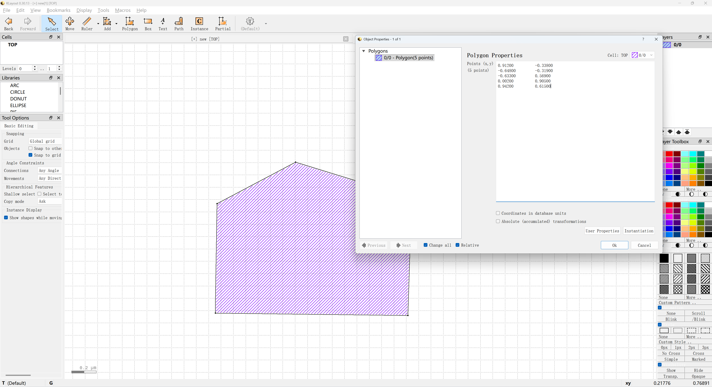
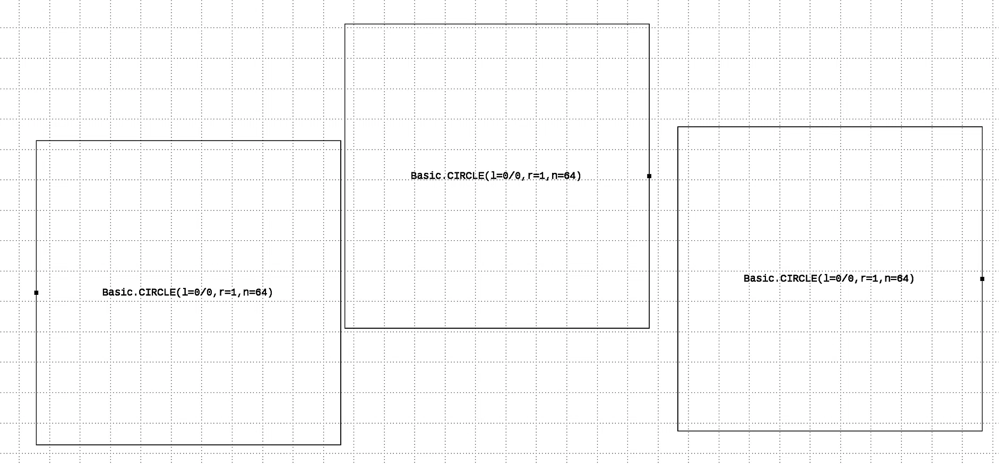
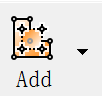
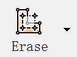
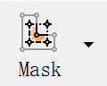
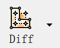

## 下载与安装

Klayout 是一个开源版图绘制软件。直接在网页搜索后选择适合自己系统的版本下载即可。

打开后通常默认为非Edit模式，可用功能受限。因此依次点击 File -> Setup -> Editing Mode，勾选 Use editing mode by default，点击Apply -> OK。退出软件重新打开。

## 界面与布局

Klayout界面如下：

 

**常用操作**（不展示所有主菜单栏内容，只展示常用的，在用中学）：

1. **新建**：（布局）File -> New Layout （层）Edit -> Layer -> New Layer
2. **设置**：File -> Setup
3. **撤回**：ctrl z
4. **删除**：选中区域 -> Delete
5. **复制**：选中结构 ctrl c+ctrl v
6. **圆角**：选中结构 Edit -> Selection -> Round Corners 
7. **图层**：Edit -> Layer，可进行复制、合并等操作
8. **修改图层**：
	1. 选中结构，选中修改后的目标图层，Edit -> Selection -> Change Layer
	2. 选中结构，Edit -> Layer -> Edit Layer Specification
9. **删除图层**：选中层，然后 Edit -> Layer -> Delete Layer
10. **修改图层格式**：右侧 Layer Toolbox里修改颜色、样式等
11. **视图填充**：View -> Show Layers Without Fill
12. **代码控制**：Macros -> Macro Development

## 基础绘图（工具栏介绍）

1. 视图：鼠标**滚轮**向上/向下可以放大/缩小视图；**右键**左上/右下形成矩形框可以缩小/放大视图；**按住**滚轮可以拖动画布。
2. **选中**：**左键**形成的矩形框可以选中内部图形；**直接点击**图形也可以选中。
3. **多边形**：
	1. 点击右侧Layers栏里要选择的图层，选中工具栏的 “Polygon”，左键选择多边形其中一个顶点的位置，到最后的顶点双击结束，按ESC退出绘制。
	2. 如果形状/位置有误，双击多边形打开 Polygon Properties修改顶点坐标，界面如下图。
	3. 图中坐标单位默认为μm。 
4. **矩形**：
	1. 先选中Layers层，再点击工具栏的 Box，点击两次确定对角顶点从而得到矩形。同样在绘制完成后按ESC键退出。
	2. 如果对于矩形大小和位置不满意，同样可以双击进入 Box Properties进行坐标尺寸修改。
5. **Path**：
	1. 选中Layer，点击Path，左侧会弹出Path Options：可以修改 Width 和 Type（需要的时候自己探索，主要是会在端点向外延伸一段距离或将端点从直角改为圆角）。
	2. 同多边形的绘制，点击一次确定节点；在终点双击结束，记得按下ESC退出绘制模式。
6. **Instance**：
	1. 选中Instance，在Tool Options 里 Library 选择 Basic，Cell 选择想要的图案 Circle/PIE等，然后设置 Rotation angle为0（默认180），再点击 PCell，在Layer里选择要绘制的图层，然后设置想要的参数，左键即可出现图案（右键可以旋转）。
	2. 一开始可能出现如下的问题，左键以后只显示边框和标签，看不到内部的图案。此时点击顶部菜单栏的 Display -> Full Hierarchy，所有实例内部的图形就会完整显示出来。 
	3. Instance中包括圆形、扇形、椭圆形、矩形、圆角Path、空心矩形、文本等。
7. 两个核心概念**Cell**和**PCell**：
	1. **Cell**单元是KLayout中最基础的层级结构，对应 GDS 文件里的 **STRUCT**。可以把它理解为一个容器，里面装着多边形、线条等图形，或者其他更小的 Cell。Cell 一旦画好，里面的图形就固定了。如果你需要一个大一点的矩形，通常只能再重新画一个。可以通过实例化（Instance） 的方式，在一个 Cell 里多次放置另一个 Cell，实现层级复用。
	2. **PCell**全称**Parametrized Cell**，它本身不是一个画好的静态图形，而是一段“生产代码”。PCell 的内容不是固定好的，而是根据设定的参数，在每次被调用时由代码动态“计算”出来的。可以在 PCell 的属性窗口里随时修改这些参数（例如把半径从 r=1 改成 r=2），KLayout 会立刻重新计算并更新图形，不需要手动重画。

## 进阶绘图

     

1. **Add**：添加，即使有重叠也直接添加到版图上。最常用。
2. **Merge**：合并，与Add不同，如果两个图案有重叠就会合并为同一个图案。
3. **Erase**：擦除，在已有结构上，选择擦除模式，根据需要绘制图案，将已有结构中想要去除的部分覆盖，即可实现擦除。
4. **Mask**：交集，先用Add添加基础图案，再选用Mask，绘制另一图案，只保留两次绘制图案中重叠的部分，即取交集。
5. **Diff**：异或，需要一点点想象力，选用Diff进行绘制两次，二者相交叠的部分会被擦除，二者各自不重合的部分会保留。
6. 后四个功能只针对同一图层的图案。如果想让**不同图层**的图案进行运算，需要选中需要运算的多个图案（注意点击次序，多个图形选择 按住Shift键逐个点击）Edit -> Selection -> Intersection - Others with First / Subtraction - Ohters From First 等。
7. 如果使用Instance单元做运算，需要先**展平**再进行运算：Edit -> Selection -> Flatten Instances。

## 测量

1. **Ruler**：左键选择要测量的线段的两个顶点即可，按住Shift可只选直线，删除时选中delete即可。
2. **Multi-ruler**：左键选择起点，点击一次确定一段测量，同时作为下一段测量的起点，测量到达终点时双击结束。
3. **Cross**：单点的坐标，直接点击要测量的点即可。
4. **Measure**：直接测量两边之间的距离（有点难选中，不是测量你选中的那条边）。
5. **Measure edge**：直接测量选中那条边的长度。
6. **Angle**：三点确定一条一个角，两边各取一个点加顶点，顺序为边上点1->顶点->边上点2。
7. **Radius**：在扇形或者圆的弧线上点三个点。
8. **Ellipse**：用Ellipse尺子画出椭圆使得其与要测量的椭圆重合，得到它的长轴和短轴。
9. **Box**：选中要测量矩形的对角点，得到其长和宽。
10. 如果要得到所选结构的面积和周长：先选中结构 Edit -> Selection -> Area and Perimeter。如果是不规则图形，例如内部掏空，会测量所有边缘的周长。

## 移动

1. 直接选用工具栏的Move，左键要移动的结构，再点击释放。
	- 如果发现只能水平和竖直拖动，可以在Tool Options里Basic Editing将其中的Movemets选项选择为“Any Direction”。
	- 由于手动拖动，移动不够精准。
2. 选中要移动的结构，Edit -> Selection -> Move By（x/y为移动的距离，可正可负）/To（将图形移动到绝对坐标，可以选择基准点）。
3. 双击要移动的结构，然后修改几个端点的坐标，但要注意不要改变图案形状（复杂不推荐）。

## 旋转

- 首先选中要进行旋转的结构，然后 Edit -> Selection -> Flip Horizontally（水平翻转）/ Flip Vertically（垂直翻转）/ Rotate Clockwise（绕中心点顺时针90°）/ Rotate Counterclockwise（绕中心点逆时针90°）/ Rotation By Angle（绕中心点旋转任意角度，正逆负顺，角度制）
- 如果选中多个结构同时旋转，会同时以它们共同的中心为圆心进行旋转。

## 布尔运算

对两个图层做布尔运算，Edit -> Layer -> Boolean Oprations：
1. **Source A** -> 选择要做运算的第一层
2. **Source B** -> 选择要做运算的第二层
3. **Mode**：Union 或；Intersection 和；Difference A非B / B非A；Symmetric Difference 或非。
4. **Result** -> 运算后结果放置在的第三层
5. **Hierarchy**：Flat 展平-无层级关系；Top cell only 只考虑Top cell的布尔运算，其余图层不考虑；Individually for current and subcells 各层各自做布尔运算，图层间不互相做布尔运算。

布尔运算还可以用来做**不同文件中结构的复制**（直接ctrl c+ctrl v不可行），在同一个界面打开两个gds文件（把文件B拖到文件A打开的窗口，选择Add layout to current panel），然后在布尔运算里Source选择不同的文件及其对应图层，然后做OR运算即可。

## 缩放（轮廓获取）

Edit -> Selection -> Scale（整体缩放） / Size Shapes（膨胀收缩）
- **Scale**：设置要缩放的倍数（factor）。
- **Size Shapes**：设置缩放的长度（相较于原长的倍数，0.2为放大到原来的1.2倍，-0.2为缩小到原来的0.8倍），可以用（dx，dy）对x和y方向设置不同缩放长度（符号需要一致）。

## 对齐

1. 选中要对齐的形状，Edit -> Selection -> Align, 选择对齐方式（X 为不做对齐操作）。首先点击选中的形状为参考图案，它不会动，其他的图案以这个为基准。
2. 选中要对齐的形状，Edit -> Selection -> Distribute，Pitch为不同结构的同一位置（比如都为正方形的左边，在 alignment中可选）的间距；Space为两个图案整体的间距（Space与alignment的设置无关）。

## 阵列

选中想要做成阵列的结构，Edit -> Selection -> Make Array。
- Columns 列；Rows 行。
- vector（x，y） 每两个相同形状之间的距离。
Instance 里可以直接放阵列（Tool Options），Array Instance 参数选项选好。
如果只想对阵列里的某个结构做操作，Edit -> Selection -> Resolve Arrays，解除阵列。

## 填充（填满晶圆）

选项：Edit -> Utilities -> Fill Tool。
- Fill Area（范围）：可选图层、图形等；还可以选择保留距离边缘多少长度不填充。
- Exclude Areas（排除区域）：先选择不想被填充的区域，然后在该栏选择“Selected layers”。
- Fill Cell（被填充的区域）：一般只选择 Fill Cell的区域，后续不用填写。
- Options：勾选 Second-order fill cell for remaining regions，会使更小的结构填充第一次填充剩余的部分。

## 一些理论

1. 多层Mask：当设计的器件比较复杂时，我们需要设计多层Mask，在klayout上，对应着多个图层。
2. Merge的作用：如果Add重叠但不Merge，无法在光刻时转化为仪器所需代码。否则最小距离是贴合。

**参考视频资源链接**：
【1、Klayout下载与安装】 https://www.bilibili.com/video/BV1yvhUzrEhy/?share_source=copy_web&vd_source=d926a141937a9dc6aff9cb918c6119ee
【Klayout掩模版设计教程和微纳加工工艺】 https://www.bilibili.com/video/BV1JG4y1R717/?share_source=copy_web&vd_source=d926a141937a9dc6aff9cb918c6119ee