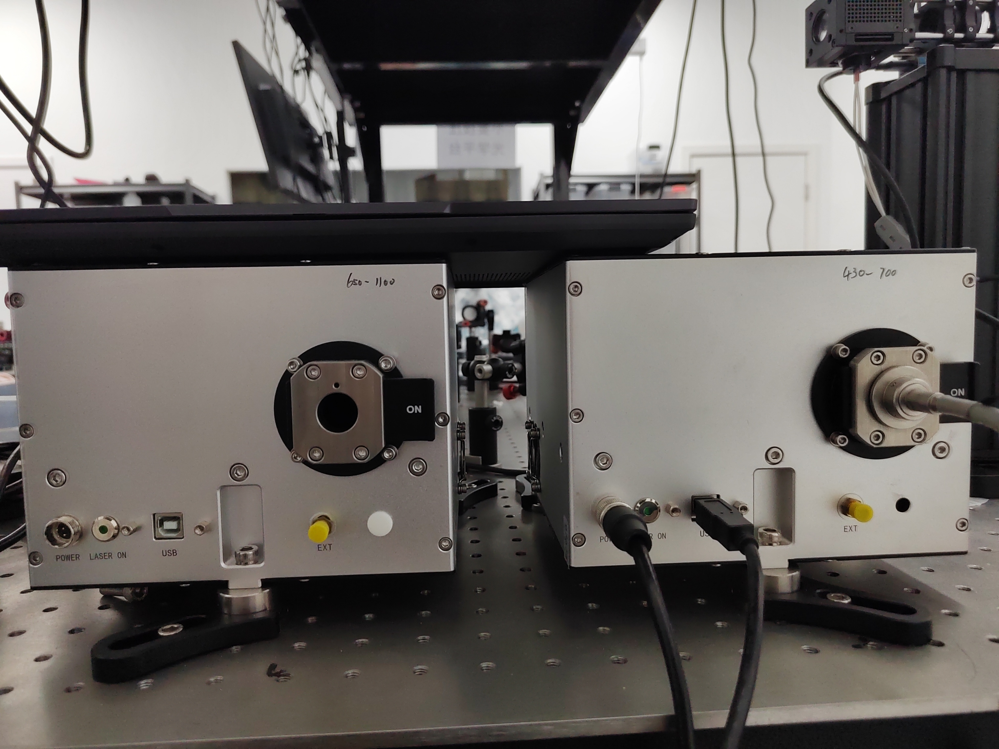
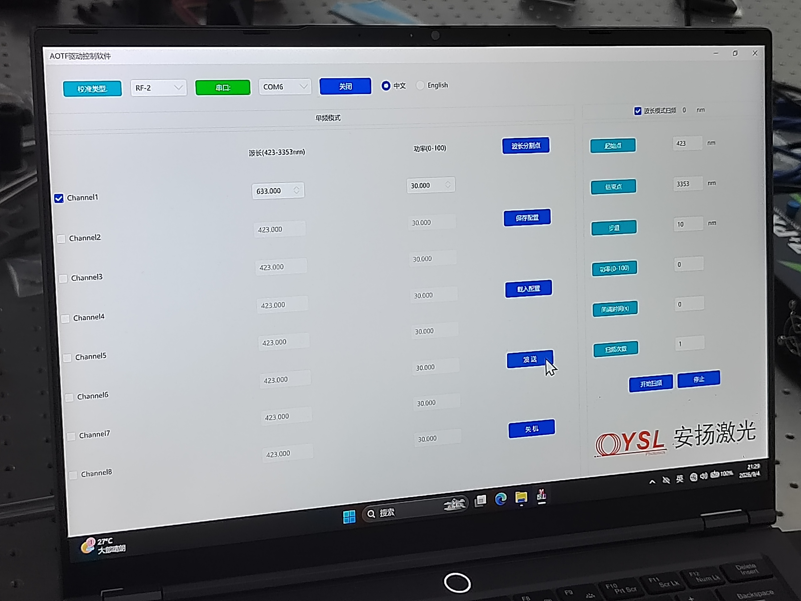
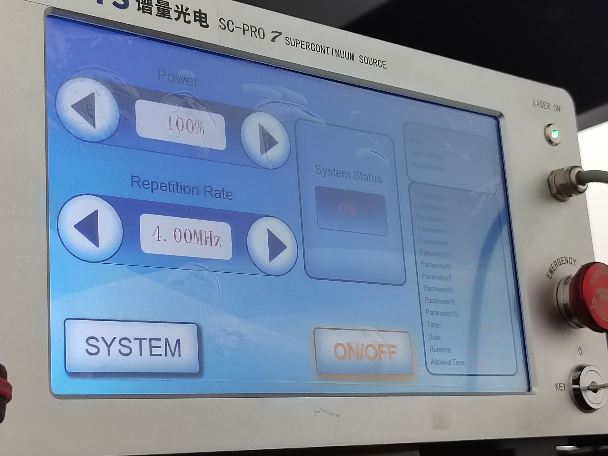
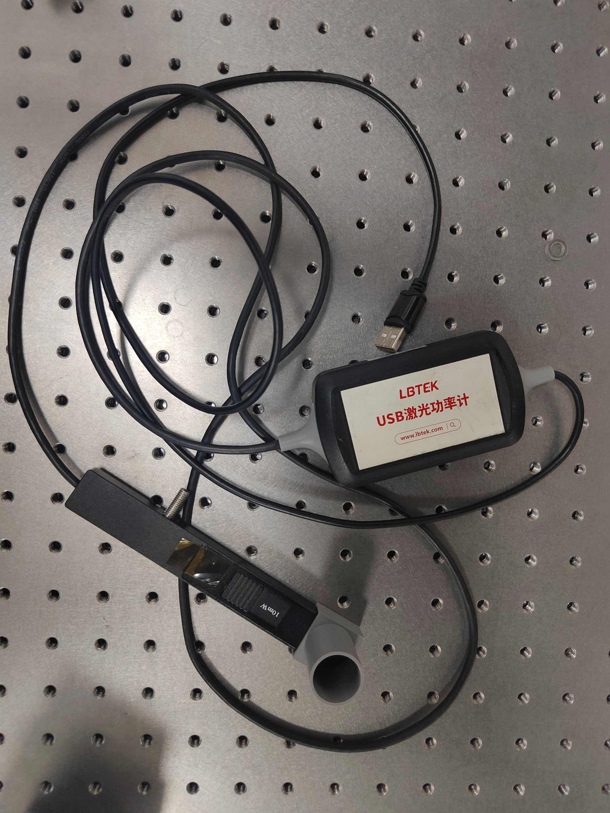
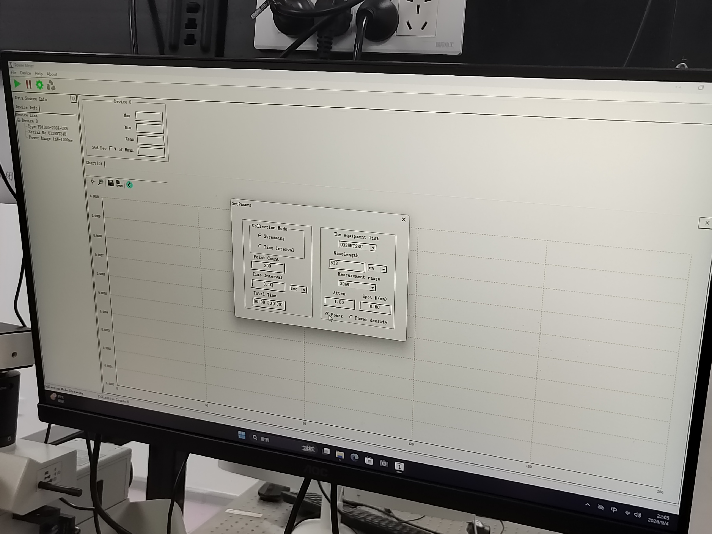
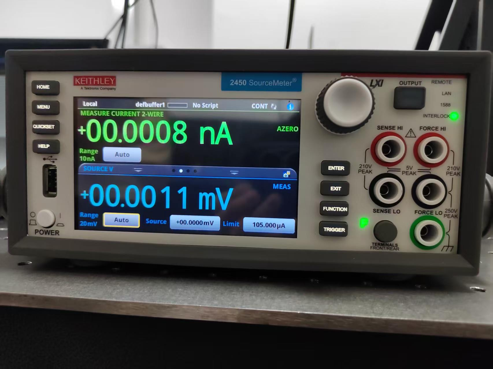
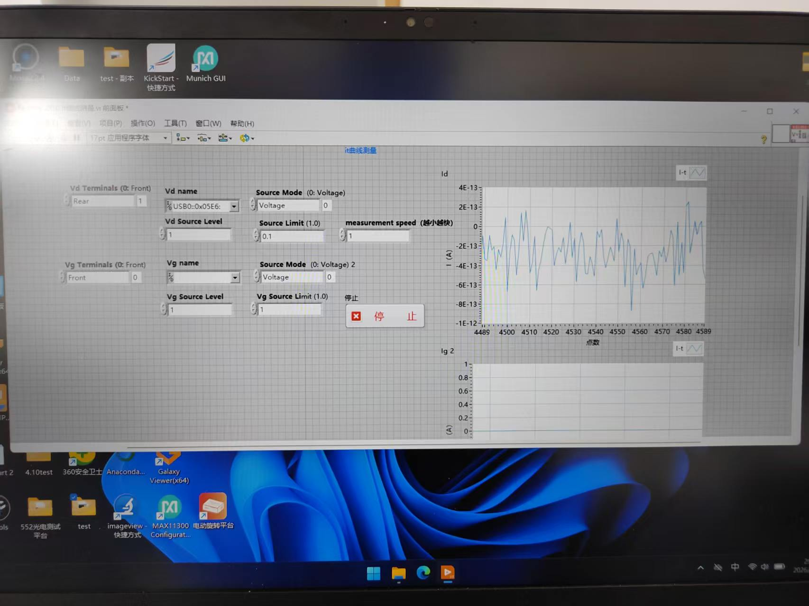

# 实验室操作记录：宽谱激光器、光功率计与源表

这篇笔记整理自我在 2026 年 9 月 6 日、9 日记录的《实验室操作记录》PPT，后续会随着实际使用持续补充。当前包括实验室基础规则、宽谱激光器、光功率计和源表三类仪器。文字由 AI 协助整理，照片来自原始记录。

> 本文是特定实验环境下的学习记录，不是经过审核的通用操作规程。设备型号、接线和软件版本可能不同，实际使用以设备手册及实验室培训为准。原笔记中的登录凭据已从公开版本移除；尚不确定的参数集中列在“待核实问题”中。

## 阅读索引

| 仪器／主题 | 本文记录 | 软件入口 |
| --- | --- | --- |
| 实验室基础 | 平台管理、光路检查、元件归位 | — |
| 宽谱激光器与 AOTF | 连接、通道与波长、功率控制 | AOTFGUI |
| 光功率计 | 工作波长、采集与数据观察 | Power Meter |
| 源表 | 接线、参数、数据保存 | LabVIEW 上位机 |

## 01 · 实验室基础规则

### 平台、区域与元件管理

- 不要倚压光学平台，原记录特别提醒避免影响平台内部气囊。
- 划分自己的实验区域，必要时放置纸条说明；不随意移动他人的仪器和光路。
- 光路上的元器件要固定牢靠，使用合适的压块和螺丝，避免碰撞后倾倒或损坏。
- 更换镜片时按实验室要求佩戴洁净手套，避免污染光学表面。
- 公用元件使用后归位；自己的芯片和器件收回专用盒中。

### 光路检查与测量环境

原记录使用光阑检查光路：在多个位置观察光束是否通过光阑中心。光阑中心的高度与位置如何设置、怎样据此判断光轴与平台平行，仍需结合实际搭建进一步整理，不能只凭一次“通过中心”就完成判断。

搭好光路后，记录光经过各元件前后的功率变化，检查衰减是否符合预期。原笔记提出了几种排查方向：元件材料与工作波段是否匹配、光路是否对准、测量中是否混入杂散光。测量位置、入射条件和探头设置应一并记录，便于后续比较。

原记录建议在测量时降低环境光干扰。关灯测量与激光安全防护是不同的问题，具体照明和防护安排应遵循实验室要求。

对于自制 PCB，原记录提到通过通断测量辅助辨认连接关系。**通断关系本身不能直接证明哪个端子是源或地**；缺少原理图时，应先确认电极定义，不能据此直接接入外部电源。

## 02 · 宽谱激光器与 AOTF 控制

### 设备与软件

原 PPT 将这套装置称为“宽谱激光器”。照片中可以看到谱量光电 SC-PRO 7 超连续谱光源控制界面，以及 AOTF 驱动控制软件。光源面板和电脑上的 AOTF 软件是两处不同的控制入口。

<figure class="lab-figure">
  <a href="../../assets/posts/laboratory-instrument-notes/laser-modules.jpg" target="_blank" rel="noopener"></a>
  <figcaption>图 1 · 原记录中的光学模块与连接外观</figcaption>
</figure>

电脑中的软件位置原记为 `D/Data/0313`（可见光），程序名称为 `AOTFGUI`。该路径仅是当时实验电脑的记录，换电脑后需要重新确认。

<figure class="lab-figure">
  <a href="../../assets/posts/laboratory-instrument-notes/aotf-software.jpg" target="_blank" rel="noopener"></a>
  <figcaption>图 2 · AOTF 驱动控制软件，包含串口、通道、波长、功率与发送按钮</figcaption>
</figure>

### 操作步骤

1. 准备电源线与信号线，确认连接关系。
2. 原记录通过光源操作盒的钥匙开关启用设备，同时启动电脑端软件。
3. 在 AOTF 软件中连接串口，选择输出通道；当时通常使用单通道。
4. 设置输出波长，点击“发送”。串口号和波长应按实际设备选择，不照抄照片中的数值。
5. 光源面板通过 `ON/OFF` 控制输出，通过 `Power` 调整功率；AOTF 软件中也有功率设置。

<figure class="lab-figure">
  <a href="../../assets/posts/laboratory-instrument-notes/laser-controls.jpg" target="_blank" rel="noopener"></a>
  <figcaption>图 3 · 光源控制面板中的 Power、Repetition Rate 与 ON/OFF</figcaption>
</figure>

原笔记记下了以 20% 为步进逐级升降功率的过程，照片中也出现了 100% 的界面状态。**这些是当次记录，不表示每次都需要升到满功率，也不是其他设备的通用设定。** 后续应补充这套设备允许的启动条件、目标功率、各级等待时间，以及光源与 AOTF 两处功率设定的关系。

### 结束使用

当时的笔记依次记录了：AOTF 软件“关机”并退出、光源侧降低功率、关闭 `ON/OFF`、钥匙恢复到 `0`，最后处理连接线。两处控制的确切关闭顺序、是否需要等待和哪些线缆需要断开，尚需对照本机手册确认后补全，暂不将这段记录作为独立关机规程。

## 03 · 光功率计

### 设备与界面

照片中的仪器为 LBTEK USB 激光光功率计，电脑端程序名为 `Power Meter`。

<figure class="lab-figure lab-figure-portrait">
  <a href="../../assets/posts/laboratory-instrument-notes/power-meter.jpg" target="_blank" rel="noopener"></a>
  <figcaption>图 4 · USB 光功率计及探头</figcaption>
</figure>

### 测量流程记录

1. 连接数据线，打开 `Power Meter` 软件。
2. 在设置窗口选择当前使用的设备，将 `Wavelength` 设置为本次测量的光波长。
3. 核对测量范围和探头适用条件，再将探头置于需要测量的位置。
4. 启动采集，观察示数与曲线，并记录波长、测量位置及当时设置。
5. 测量结束后停止采集、保存需要的数据，再关闭软件并归置仪器。

<figure class="lab-figure">
  <a href="../../assets/posts/laboratory-instrument-notes/power-meter-software.jpg" target="_blank" rel="noopener"></a>
  <figcaption>图 5 · 光功率计设置窗口，可见 Wavelength、Measurement range 和采集设置</figcaption>
</figure>

界面照片中还包括 `Collection Mode`、`Point Count`、`Time Interval`、`Atten`、`Power / Power density` 等选项。当前笔记只明确记录了测量前修改工作波长；其他选项的含义、零点校准方法及探头量程需要在后续使用时补充。图中数值仅为当时状态，不作为默认参数。

## 04 · 源表与 LabVIEW 上位机

### 设备与用途

照片中的设备为 **Keithley 2450 SourceMeter**。原记录关注的是给器件施加电压或电流，同时测量响应，并通过上位机记录 I–t、V–t 等曲线。

<figure class="lab-figure">
  <a href="../../assets/posts/laboratory-instrument-notes/sourcemeter.jpg" target="_blank" rel="noopener"></a>
  <figcaption>图 6 · Keithley 2450 源表正面</figcaption>
</figure>

原 PPT 中“约 10⁻¹³～10⁻¹⁴ 的测量精度”和“最好测 10⁻⁵ 左右的小信号”的说法没有明确单位、量程及条件，本次不把它们整理成设备规格。分辨率、准确度、噪声和允许输入范围需要分别核实。

### 接线与软件选择

原记录使用后面板端口，通过 USB 连接电脑，并使用 LabVIEW 编写的上位机。软件记在实验电脑的 `test` 文件夹中，根据需要选择对应的测量程序。

原笔记将器件连接概括为“源和地”，这不足以替代实际接线图。正式接线前需要补充器件电极、源表 FORCE／SENSE 端子、两线或四线方式的对应关系；前后端子选择应与实际接线一致。

<figure class="lab-figure">
  <a href="../../assets/posts/laboratory-instrument-notes/labview-software.jpg" target="_blank" rel="noopener"></a>
  <figcaption>图 7 · LabVIEW 测量界面，包含端子、设备名称、源模式、输出值、限值与测量速度</figcaption>
</figure>

### 参数速查

| 界面字段 | 当前记录 | 后续需要补全 |
| --- | --- | --- |
| `Vd Terminals` | 当时选择 `Rear`，使用后面板 | 与本次接线一致的端子选择 |
| `Vd name` | 用于选择连接设备 | 对应的 USB／仪器资源标识 |
| `Source Mode` | 界面可见 `Voltage` | 本次使用电压源还是电流源 |
| `Vd Source Level` | 调整源输出设定值 | 单位、器件允许范围与设定依据 |
| `Source Limit` | 原记录称为电流限制 | 当前源模式下限值的具体含义 |
| `measurement speed` | 原笔记尚不确定是否指积分时间 | 单位、程序实现及与采样间隔的关系 |

### 开始、保存与结束

原记录的上位机操作是：选择设备及端子，设置源参数和限值，再启动测量。重新测量前先停止上一轮；需要清除曲线时先保存数据，再清除并开始下一轮。

数据有两条查找路径：一是从当前图表右键导出；二是按时间查找程序自动保存的文件。**“每次启动都会自动保存”是对当时程序的记录**，后续应确认实际保存目录、文件名、时间戳和是否确实落盘。

原记录结束时先停止测量、退出软件，再关闭源表。还需要确认上位机的“停止”是否同时关闭源表输出；在这个问题核实前，不能把停止采集等同于输出已关闭。

## 05 · 待核实与后续补充

| 主题 | 待补充的问题 |
| --- | --- |
| 光路对准 | 多个光阑的高度和中心怎样设置，如何判断光轴平行 |
| 宽谱光源 | 型号对应手册、启动条件、功率设置与关机顺序 |
| AOTF | 可用通道、波长范围与功率控制的实际含义 |
| 光功率计 | 探头型号、量程、校准和零点处理、宽谱测量设置 |
| 源表 | 接线图、输出限值、量程、准确度与分辨率 |
| LabVIEW | measurement speed 的含义，停止按钮对输出的影响 |
| 数据管理 | 自动保存路径、命名规则、导出格式和备份方法 |

## 06 · 后续记录模板

以后新增仪器或补做实验，可以按下面的结构继续写在本文中；重要修订记入末尾的更新记录。

<details class="lab-template">
<summary>展开可复制的记录模板</summary>

```markdown
## 仪器名称／本次操作主题

### 日期与目的
- 日期：
- 本次希望完成的测量：

### 设备与连接
- 仪器型号、软件版本：
- 接线或光路图：
- 操作依据／手册位置：

### 参数与过程
| 参数 | 数值与单位 | 设定依据 |
| --- | --- | --- |

### 结果与数据
- 数据保存位置：
- 异常现象及处理：
- 本次确认了什么：
- 仍需核实什么：
```

</details>

## 更新记录

- **2026-09-29**：根据 2026-09-06、09-09 的 PPT 整理首版 Markdown，保留仪器照片和软件界面，移除登录凭据，将未确认的参数与流程单列为待核实问题。
