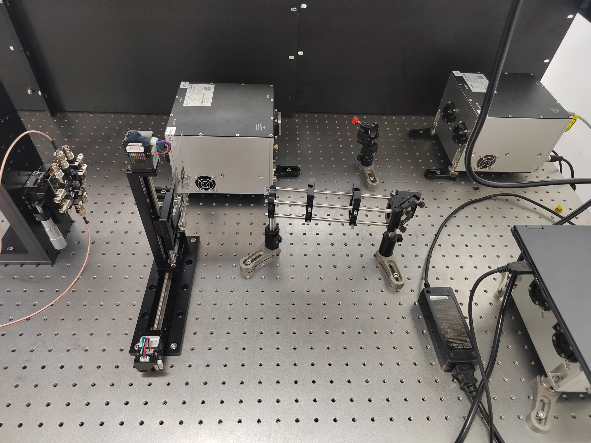

# 光路搭建 SOP：双镜走光束与笼式系统对准

## 背景



图中是我搭建光路时使用的扫描实验装置，可见两个转向反射镜、笼式导向结构与二维电动位移台。以下沿用实验中的命名：后方独立镜架上的反射镜为 M1，笼式结构右端转接件上的反射镜为 M2；光经 M2 后向图中左侧传播。笼式系统的具体规格和探测端型号，应以实物与说明书为准，不能仅凭照片确定。

作为我进入直博阶段第一次搭光路实验，在观摩师兄搭建光路时有很多疑惑点，例如：

1. **为什么不能“直接把光打到目标器件上”，而必须大费周章调水平和共轴？甚至在我自己调试的时候，把中间带铁杆的架子（笼式系统）调水平后，光反而不平了，打不到最左侧的器件上；那么为什么非要追求水平和正入射？**

2. **把光阑放在笼式架子的左、中、右位置，到底在调什么？为什么要换位置放光阑？背后控制的物理量是什么？**

3. **为什么调反射镜俯仰/偏摆时，总是无法让光束在全光路上都通过光阑中心？怎么建立对应关系？动了M1或者M2，顾头不顾尾，近处准了远处偏，远处准了近处偏。**

因此，为了帮助自己和有相同困惑的朋友理解其中原理，减少出现光路搭建上的问题，我咨询与实践后整理出这份文档，用以回答上述问题并给出针对“**光学平台对准与搭建**”的 **SOP**。

## 核心问题释疑（Q&A）

下文讨论的是近轴、小角度条件下的光束中心线对准。用 Z 表示目标传播方向，X、Y 表示两个横向方向，θₓ、θᵧ分别表示沿 X、Y 的小倾角。**两点过心验证的是中心线的位置和方向，不能单独证明光束已准直**；光束发散或会聚还需通过不同传播距离处的束宽等测量判断。

### 问题 1：为什么不能“直接把光打到目标器件上”，而必须大费周章调水平、调共轴？

**解答：**

- **三维空间解耦与可扩展性**：光学平台上的阵列螺孔和水平面构成了一个**笛卡尔坐标系（X, Y, Z）**。如果光束与桌面不平行（存在竖直方向倾角 θᵧ）且不沿螺孔阵列方向（存在水平方向倾角 θₓ），当我们沿着光路前后移动某个器件（比如在笼式导轨上滑动透镜或测试不同工作距离）时，**纵向移动（Z）会耦合出横向偏移（ΔX, ΔY）**。这会增加后续插入或移动器件时的重新对准工作。水平、沿孔阵列是便于维护的布局选择；真正的目标是符合系统设计的光轴，设计要求倾斜的光路不必强行调水平。

- **笼式系统是“刚性机械轴”**：图中中间带有四根不锈钢杆的结构，其机械中心轴是由两端接杆的高度决定的。如果我们把笼式系统调到在所需精度内与台面平行，但光束本身是斜着射入的，光自然就会打偏。正确的逻辑是：**先确立机械轴与桌面平行，再通过两个反射镜把光束“掰”到在容差内与机械轴重合**。

- **器件物理特性限制**：器件应按设计入射角使用：干涉滤光片的入射角增大时通带通常会向短波移动，波片延迟量及偏振器件性能也可能变化。透镜偏心或倾斜可能引入彗差、像散或焦点偏移，程度取决于光学设计和偏差大小。正入射并非所有器件的要求，例如常见转向镜按约 45° 入射设计，PBS 也有各自规定的使用几何。

### 问题 2：把光阑放在笼式架子的左、中、右位置，到底在调什么？

**解答：**

- 几何光学基本定理：**两点确定一条直线**。

- 在给定参考截面上描述近轴光束中心线，需要 **4 个自由度**：横向位置 (x, y) 和传播角度 (θₓ, θᵧ)。

- 当光阑放在**最右侧**（靠近入口转接镜）时，它约束的是光束进入笼式系统的**初始空间位置** (x₁, y₁)。

- 当光阑放在**最左侧**（远离入口的出口端）时，由于经过了一段传播距离 L，微小的角度偏差会被放大为明显的位移偏差（Δx ≈ L · θₓ）。因此，在近端位置已经确定的条件下，远端光阑进一步约束光束的**传播角度/方向** (θₓ, θᵧ)。

- 放在**中间**的光阑通常作为过渡辅助，或者用于验证光束是否真正沿直线对中；中途不居中时，应检查光阑复位、笼板安装、遮挡与机械应力，不能只凭这一现象断定笼杆弯曲。

### 问题 3：为什么调反射镜俯仰/偏摆时，总是无法让光束在全光路上都通过光阑中心？怎么建立对应关系？

**解答：**

- **单反射镜的局限**：一个常见双轴反射镜架提供 2 个角度自由度，会同时影响下游光斑位置和方向，但无法独立满足一般情况下的位置与角度共 4 个约束。如果只调笼式系统入口处那一个反射镜，通常只能满足一个截面的位置约束；只有入射几何原本合适时，才可能同时通过两个光阑。

- **双反射镜配合（Beam Steering）**：一般可用两个有间距的反射镜（M1 和 M2）配合控制位置与方向；只有采用特定升降布局时才称为潜望镜结构。规定图中后方独立立柱上的红色旋钮反射镜是 **M1**，固定在笼式系统右端直角框上的反射镜是 **M2**。

- **控制规则（重中之重）**：

    - **M1（前级镜）控制近端位置（光阑 1，靠近 M2 处）**；

    - **M2（后级镜）控制远端位置/角度（光阑 2，远离 M2 处）**。

    - 如果不按这个对应关系，而是像我一开始用 M2 去调近端、或者凭感觉乱拧，就容易反复破坏前一次调整，降低收敛效率。这一口诀适用于近端光阑靠近 M2 的布局，两面镜子的作用并非完全解耦。

- 当**调节螺丝拧到底**却依然**无法让光斑到位**时，通常意味着单纯靠**反射镜的微调角度**已经**无法弥补空间平移或初始基准的偏差**。常见原因包括**镜架行程耗尽、初始位置不合适或上游基准变化**。可按下面的顺序排查：
    1. **机械归中与底座整体平移（解决调整架行程耗尽）**：将两枚微调螺丝退回到各自行程的大致中间位置（保证两边都有余量）。然后，松开该反射镜座在光学平板上的固定螺丝/压板，在遮断光束后微调整个镜座在台面上的平移和偏转，固定后以低功率复查，逐步让光斑落到目标光阑附近，再锁紧底座，最后用螺丝精调。

    2. **复核几何布局与上游基准**：若不能同时通过前后光阑，应逐项检查光阑中心是否共线、两镜间距与口径是否足够、入射点是否靠近镜面边缘、镜架是否有足够行程，以及上游光束是否漂移。上游倾斜本身可以由合适的双镜组合补偿，并不必然要求激光器先与台面平行。确需改动上游基准时，再按设计重新对准并复核整段光路。

## 规范化光路搭建标准流程（SOP）

对于本文这类自由空间转向光路，可以把没有中间聚焦元件的直线段作为对准单元，按以下三个阶段操作；包含透镜、共轭面或光纤耦合的段还需要各自的对准步骤。

### 阶段一：布局规划与机械基准建立（不开激光或低功率模式）

1. **低功率与光束终止**：机械安装、移动底座时先关闭或遮断光束；调光时使用可行的最低功率，佩戴适合波长和功率的防护眼镜，并在调整段下游及可能漏光的位置设置光束终止器。通过合适的观察卡或相机间接观察，不迎着光束或镜面反射观察，尤其不能用肉眼寻找不可见红外光。

2. **电源与线缆布局**：将激光器电源、控制器放在光学平台边缘或架子上（避免大功率发热源直接在光路下方引起空气热湍流），所有线缆用扎带或固线器固定在平台边缘，防止拉扯光学调整架。保证光路实际搭建区域空旷便于规划与后续搭建工作。

3. **规划正交网格**：尽量让光路沿着光学平台螺孔的行或列铺设。

4. **统一光学中心高度**：

    - 以最难调节高度的笨重器件（如本示例里的激光器出光口，或左侧XY电动位移台的扫描中心）为基准，设定一个全局高度 H（测量得到例如 H = 100 mm 或 125 mm）。

    - 使用钢尺或专用高度尺，将两个光阑调节到高度 H 并锁死在底座上。

5. **搭建笼式系统机械骨架**：

    - 先将笼式系统两端的支撑立柱调节到等高，在两端实测机械中心高度，必要时用水平仪辅助；只有支撑组件规格和基准一致时，套筒暴露长度才可作为辅助比较，不能仅凭它保证笼杆平行。

    - 通过底部的压块将底座牢牢锁死在平台螺孔上，确保笼杆方向与平台螺孔阵列平行。注意，光学平台上的元器件在暂时不动的情况下必须及时拿压块固定，防止自己或别人不小心碰倒导致元器件损坏（真实事件），同时避免误碰导致位置需要重调。

### 阶段二：粗调

1. **机械归零**：在把反射镜架装入光路前，先旋转其背部的两个调节螺母，使其处于**行程的中间位置**（避免调到一半发现螺丝拧到底或者脱扣）。

2. **安放 M1 与 M2**：

    - 将光束从激光器射出，打在 M1（图中后方独立反射镜）的镜面几何中心附近。

    - 先遮断光束，再整体旋转 M1 的底座并粗略移动位置；固定后以低功率复查，逐步让反射光落在 M2（笼式系统右端转向镜）中心附近。需要再次松动底座时，先遮光。

    - 锁紧 M1 和 M2 的底部压块螺丝。**注意：锁紧底座瞬间光斑通常会轻微偏移，这是正常现象，后续靠精细螺丝补偿。**

### 阶段三：精调——“双镜走光束法”

这是光学工程最核心的基本功。现在我们要把光束精准导入笼式系统的正中心轴：

1. **放置双光阑**：

    - **近端光阑（A₁）**：卡在笼式系统最右侧（紧贴 M2 出口处）。

    - **远端光阑（A₂）**：卡在笼式系统最左侧（靠近电动扫描台处）。

    - **拉开距离**：A₁ 和 A₂ 之间的距离越远，在相同横向读数误差下可分辨的角度误差越小；仍需兼顾光束口径、遮挡及机械稳定性。

2. **迭代循环操作（核心口诀：“前镜调近，后镜调远”）**：

    - **Step 1（看近调前）**：将远端光阑 A₂ 完全打开（让它不起作用），把近端光阑 A₁ 先缩到接近光斑大小；精调时可略微截光，但不以严重截光后的图样作为唯一依据。观察 A₁ 上的光斑，**只调节 M1（前镜）的俯仰和偏摆旋钮**，使光斑正中穿过 A₁。

    - **Step 2（看远调后）**：将近端光阑 A₁ 完全打开，把远端光阑 A₂ 缩小。观察 A₂ 上的光斑（如果偏得太远看不见，在低功率下用适合波长和功率的漫反射观察卡、红外观察卡或相机，在 A₂ 附近定位光斑，并确保透射光被终止），**只调节 M2（后镜）的俯仰和偏摆旋钮**，使光斑正中穿过 A₂。

    - **Step 3（重复收敛）**：因为 M2 动了不会影响 A₁ 太多（因为 A₁ 离 M2 极近，力臂短），但 M1 动了会同时改变 A₁ 和 A₂。因此，回到 **Step 1** 重新微调 M1，再执行 **Step 2** 微调 M2。

    - 重复迭代，直到两端残余偏差满足实验容差；轮数取决于初始误差和布局。再用中间位置复核，记录可接受的偏差，而非只凭“看起来完美”判断。

### 为什么近端光阑要靠近 M2？

在单个横向方向上，把折叠光路展开成直线，设 M1 至 M2 的有效传播距离为 a，M2 至近端光阑的距离为 b，两光阑间距为 L。令 u、v 分别是两镜微调造成的有效出射角变化；镜面实际转角还涉及反射角约两倍的关系，下面直接使用光束角变化。

近端和远端的位移响应为：

```text
Δx近 = (a + b)u + bv
Δx远 = (a + b + L)u + (b + L)v
```

在理想线性模型中，每轮先用 M1 消除近端误差，再用 M2 消除远端误差；完成一整轮后，残留近端误差相对于上一轮缩小的比例为：

```text
q = b(a + b + L) / [(a + b)(b + L)]
```

当 a、L 为正时，q 小于 1；b 越小，通常收敛越快。若 a 很小，两镜作用趋于相似，收敛也可能很慢。因此不能只用 b/(L+b) 作为一般情况下的一整轮收敛比。实际系统还受旋钮串扰、回差、漂移和读数误差影响，不保证固定轮数达到目标。

## 进阶扩展——加入透镜、样品与探测器（应对未来场景）

本扫描平台目前实际只包含两个反射镜元件，为了提前做好更复杂光路搭建的准备，扩展后续再加入元器件时的操作。

当我们把上面那条“基准主光轴”调好后，先保留 M1、M2 的设置。 这条光束就是系统的核心基准。后续插入器件时，优先“调器件去匹配基准光轴”。需要重新定义光轴或完成系统级优化时，可以有记录地调整基准镜，并重新验收上下游。

### 1. 如果未来需要在笼式系统中加入透镜

- **原则：按设计逐个加入并验收，分别检查透镜的横向位置、倾角、轴向位置和输出光束。安装顺序取决于系统布局。**

- **操作步骤**：

    1. 在没放透镜前，确认光束穿过远端光阑 A₂ 中心，并在更远处的接收屏（或探测器前）记录下未加透镜时的基准光斑位置。

    2. 放入透镜：先让光束通过透镜有效口径中心附近。即使对中正确，透镜也会改变束宽和会聚／发散状态；不能把所有光斑变化都归因于偏心。
    3. **调节横向位置与倾角**：以基准轴为目标，在两个下游截面观察光束中心，并结合透镜的设计朝向迭代调节。只让一个截面的光斑回到原位，不能独立确定位置与角度都正确。
    4. **回反辅助检查**：可在透镜上游用带孔观察卡观察表面回反。平面表面的回反可辅助判断该表面的法线方向；球面透镜不同表面的回反还受曲率、偏心和焦点位置影响。单个鬼影回到原孔不能证明整个透镜已完全共轴，须结合透射光、其他表面反射及成像表现复核，并控制返回激光器的反馈光。
    5. **验收输出**：按目标检查焦点、束宽、像质或准直状态。

### 2. 扫描样品台的正入射准直

- 图中左侧为二维电动扫描台。如果实际运动平面相对设计焦平面倾斜，横向扫描就会伴随轴向位移，聚焦成像时可能离焦。样品表面倾角与位移台运动平面误差是两项不同的问题，需要分别检查。

- **检验方法**：用可靠固定的平面反射镜检查样品安装面的朝向，低功率观察回反；载玻片可能有双面反射，需辨认。回反只检验该表面的法线，不能直接证明扫描运动没有轴向误差。还应在扫描范围内多点测量高度、焦点或清晰度，分别调整样品安装与平台姿态。

### 3. 终端探测器（光电二极管 / 光纤接收端）的对准

- 图中最左侧可见带多路接口的探测端。接口外观不足以判断它是普通光电二极管、四象限探测器还是其他结构，操作前先核对型号、有效面积、带宽和允许入射功率。

- 保持入射光轴固定，在不饱和且不超过损伤阈值的条件下调接收端。大面积二极管可能有一片响应平台，信号最大不等于几何中心；四象限器件可结合总信号与归一化差分判断居中。光纤耦合则通常还要调角度和轴向位置，以耦合功率及稳定性验收。

## 重要操作细节与常见问题

### **用内六角扳手锁紧底座时，最后一下要控制力度并观察光斑**

**原理**：光学平台螺孔与压块之间存在摩擦力矩，拧紧瞬间金属弹性形变会导致接杆产生微小的角度或位置变化，远端位移还取决于传播距离，不能预先固定为几毫米。

**常见错误**：不锁底座就调反射镜，调好后再锁底座，结果全偏了。

### **调节反射镜时，尽量用一致的方向完成最后微调**

**原理**：常见弹簧预载镜架可能存在回差或静摩擦，最后从一致方向接近目标有助于提高重复性。旋钮与光斑的实际对应关系以镜架结构为准，不把顺时针一概视为更稳定。

**常见错误**：螺丝已经拧到最松脱开了还在拧；或者超过行程继续施力，造成过大预载甚至损坏。

### **光阑缩到多小最合适？**

**原理**：缩到光阑孔径略小于高斯光束直径（约光斑边缘均匀照亮光阑叶片内圈）；必要时用截光对称性辅助判断。仅在可安全间接观察的条件下使用图样作辅助；光阑后的环纹不一定处于夫琅禾费远场，精度要求高时应测量光束中心。

**常见错误**：光阑开得太大，肉眼根本看不出偏了 1 mm；或者缩得太死，光全挡住了后面看不见。

### **接杆尽量选粗、选短**

**原理**：在端部横向力 F、线性弹性及同一截面等假设下，理想悬臂梁端部挠度 δ = FL³/(3EI)。实际镜架还受底座、夹紧方式和共振特性影响。接杆越细长，环境振动（空调、风扇、脚步）引起的光斑抖动越剧烈。

**常见错误**：用一根极长的细接杆伸出很长一截，而不换用增高底座。（注：具体使用的长短要依据系统光束高度来）

### **笼式系统装好后要锁紧侧面的紧定螺丝**

**原理**：笼杆穿过笼板时有微小间隙（公差），如果不把侧面的小内六角顶丝拧紧，笼板其实是会轻微晃动的。

**常见错误**：光阑在笼杆上滑来滑去，每次停下来的角度都不一样，导致准直基准飘忽不定。

## 1 分钟快速检查清单

在光路搭建工作结束一阶段甚至日常实验前后，可以按以下顺序排查：

- [ ] **Check 1（防呆检查）**：所有固定压块、接杆锁紧旋钮是否有松动？（先检查固定件；需触碰底座时避免接触光学面或进入光束路径，随后复查光斑有无不可恢复的偏移）。

- [ ] **Check 2（近端基准）**：将光阑放到笼式系统最右端（近端 A₁），光束是否居中？（若偏，先检查光阑复位、机械松动与上游漂移；确认原因后再调，避免掩盖故障）。

- [ ] **Check 3（远端基准）**：将光阑移到笼式系统最左端（远端 A₂），光束是否居中？（若近端准而远端偏，确认机械基准稳定后可从 M2 入手，调后仍需复查近端）。

- [ ] **Check 4（线缆应力）**：检查步进电机线、探测器同轴线（BNC）是否处于自然松弛状态，确保扫描台运动到极限位置时不会拉扯光路元件。

祝大家的光学实验都能做得顺利！

## 核对与参考资料

本文由 ZhaoYan 的实验疑问和操作记录整理，并经 Gemini 4 Argon、GPT-6.1 Sol 协作校订。双镜法适用条件、回反判断和低功率调光原则参考以下资料；装置的具体器件参数与验收容差仍需按实物和实验要求确认。

- [Newport：延迟线对准应用说明](https://www.newport.com.cn/medias/sys_master/images/images/h58/h35/8797051486238/Application-Note-Delay-Line-9848-KT.pdf)：双镜控制位置与角度、近远位置交替调整。
- [Dean Lab：Walking A Beam Through Two Irises](https://thedeanlab.github.io/altair/getting_started/optical_alignment_walking_beam.html)：光阑布局与走光束操作。
- [Dean Lab：Back-Reflection Alignment](https://thedeanlab.github.io/altair/getting_started/optical_alignment_back_reflections.html)：不同光学表面回反的解释与后续验收。
- [Edmund Optics：滤光片倾斜的影响](https://www.edmundoptics.com/knowledge-center/frequently-asked-questions/optics/optical-filters/what-happens-when-an-optical-filter-is-tilted/)：入射角增大时的通带蓝移。
- [宾夕法尼亚州立大学：Laser Safety Alignment Procedures](https://ehs.psu.edu/laser-safety-alignment-procedures-class-3b-4-lasers)：低功率、间接观察与杂散光终止。
